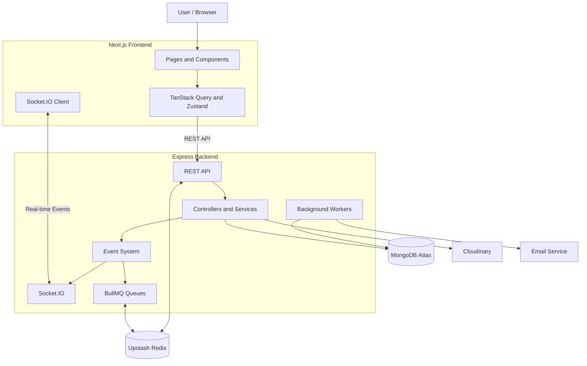

# AdminSphere

**A full-stack admin and task management platform built with Next.js, Node.js and MongoDB.**

AdminSphere is an independently developed full-stack application focused on practical backend engineering, scalable application architecture and real-world application workflows.

The project brings together authentication, role-based access control, task management, real-time updates, background processing, reporting and production deployment.

[Live Application](https://adminsphere.in) · [Architecture](docs/architecture.md)

## Overview

AdminSphere provides an administrative workspace for managing users, tasks, notifications and operational activity.

The project is designed around a modular backend architecture, with clear separation between controllers, services, middleware, policies, events and integrations. The frontend follows a feature-oriented structure using Next.js App Router.

## Key Features

### Authentication and Security
- JWT authentication using HTTP-only cookies.
- Access and refresh token rotation.
- Redis-backed multi-session management.
- Refresh-token reuse detection and session revocation.
- Google OAuth 2.0 authentication and account linking.
- Password reset and temporary account lockout.
- Role-based access control and resource-level authorization.

### Task Management
- Task creation, editing and soft deletion.
- Task assignment and reassignment.
- Priority, status and due-date management.
- Comments and file attachments.
- Activity tracking and permission-based operations.

### Real-Time Communication
- Authenticated Socket.IO connections.
- User-specific and dashboard-related rooms.
- Real-time task and dashboard updates.
- Persisted notifications and unread counts.
- Frontend synchronization through TanStack Query.

### Background Processing
- BullMQ queues backed by Redis.
- Separate API and background worker processes.
- Asynchronous email delivery.
- Scheduled PDF report generation and email delivery.
- Configurable concurrency, retries and backoff.
- Graceful worker shutdown.

### Reporting and File Management
- PDF generation using Puppeteer and EJS.
- Excel exports using ExcelJS.
- File uploads through Multer and Cloudinary.

## Technology Stack

| Area | Technologies |
|---|---|
| Frontend | Next.js, React, TypeScript, Tailwind CSS |
| State management | TanStack Query, Zustand |
| Forms and validation | React Hook Form, Zod |
| Backend | Node.js, Express |
| Database | MongoDB, Mongoose |
| Caching and queues | Redis, BullMQ |
| Authentication | JWT, Google OAuth 2.0 |
| Real-time | Socket.IO |
| File storage | Cloudinary |
| Reporting | Puppeteer, ExcelJS |
| Scheduling | node-cron |
| Logging | Winston, Morgan |
| Frontend deployment | Vercel |
| Backend infrastructure | AWS EC2, Nginx, PM2 |

## Architecture

AdminSphere consists of two independently running applications:

- **Client:** Next.js frontend responsible for pages, UI components, client-side state and API communication.
- **Server:** Express backend responsible for authentication, authorization, business logic, database operations, real-time communication and background jobs.

MongoDB stores persistent application data. Redis supports session management and BullMQ job processing.



For a detailed explanation of the architecture and application flows, see [System Architecture](docs/architecture.md).

## Project Structure

```text
adminsphere/
├── client/
│   ├── app/
│   ├── components/
│   ├── hooks/
│   ├── lib/
│   ├── providers/
│   ├── schemas/
│   ├── services/
│   ├── store/
│   └── types/
│
├── server/
│   ├── docs/
│   ├── src/
│   │   ├── config/
│   │   ├── controllers/
│   │   ├── cron/
│   │   ├── events/
│   │   ├── integrations/
│   │   ├── middlewares/
│   │   ├── models/
│   │   ├── policies/
│   │   ├── queues/
│   │   ├── routes/
│   │   ├── services/
│   │   └── utils/
│   └── views/
│
├── docs/
│   └── architecture.md
│
├── .gitignore
└── README.md
```

The frontend and backend maintain separate dependencies and development workflows.

## Getting Started

### Prerequisites

- Node.js 24
- npm
- MongoDB instance
- Redis instance
- Required external service credentials for the features you want to run

### 1. Clone the repository

```bash
git clone <repository-url>
cd adminsphere
```

### 2. Set up the backend

```bash
cd server
npm ci
```

Create a `.env` file using the provided `.env.example` and configure the required backend environment variables.

Start the development server:

```bash
npm run dev
```

The backend API runs on port `5005` by default.

### 3. Set up the frontend

Open another terminal:

```bash
cd client
npm ci
```

Create a `.env.local` file using the provided `.env.example` and configure the backend API URL.

Start the frontend:

```bash
npm run dev
```

The frontend runs at:

```text
http://localhost:3005
```

The backend API uses the `/api/v1` prefix.

**Note:** The frontend and backend must be configured to communicate with each other. Some features also require external services such as MongoDB, Redis, Google OAuth and Cloudinary.

## Useful Commands

### Backend

| Command | Description |
|---|---|
| `npm run dev` | Start development server |
| `npm start` | Start production server |
| `npm test` | Run tests |
| `npm run check` | Check server syntax |
| `npm run format` | Format backend code |
| `npm run format:check` | Check formatting |

### Frontend

| Command | Description |
|---|---|
| `npm run dev` | Start development server |
| `npm run build` | Build production application |
| `npm start` | Start production application |
| `npm run lint` | Run ESLint |
| `npm run format` | Format frontend code |

## Documentation

| Document | Description |
|---|---|
| [System Architecture](docs/architecture.md) | Application structure, authentication, authorization and system communication |
| [Background Jobs](server/docs/background-jobs.md) | BullMQ queues, workers, retries, concurrency and scheduled jobs |
| [CI/CD Overview](server/docs/cicd.md) | Backend CI/CD process and deployment overview |
| [Frontend README](client/README.md) | Frontend setup, features and implementation details |
| [Backend README](server/README.md) | Backend setup, features and implementation details |

## Deployment

The production application uses separate hosting environments:

- Frontend deployed on Vercel.
- Backend hosted on AWS EC2 behind Nginx.
- PM2 manages the backend API and background worker processes.
- MongoDB Atlas provides database hosting.
- Upstash Redis supports session management and background processing.
- HTTPS is configured using Let's Encrypt and Certbot.

Backend CI/CD automates validation and deployment. Production-specific workflows and infrastructure configuration are intentionally maintained outside this public repository.

## Project Goals

AdminSphere was built to explore and implement practical engineering concepts beyond basic CRUD development, including:

- Modular backend architecture and separation of concerns.
- Secure authentication and session management.
- RBAC and resource-level authorization.
- Event-driven application workflows.
- Real-time client-server communication.
- Asynchronous background processing.
- Logging, error handling and graceful shutdown.
- Automated testing and CI/CD.

## License

No license has been specified yet. All rights are reserved unless a license is added to this repository.