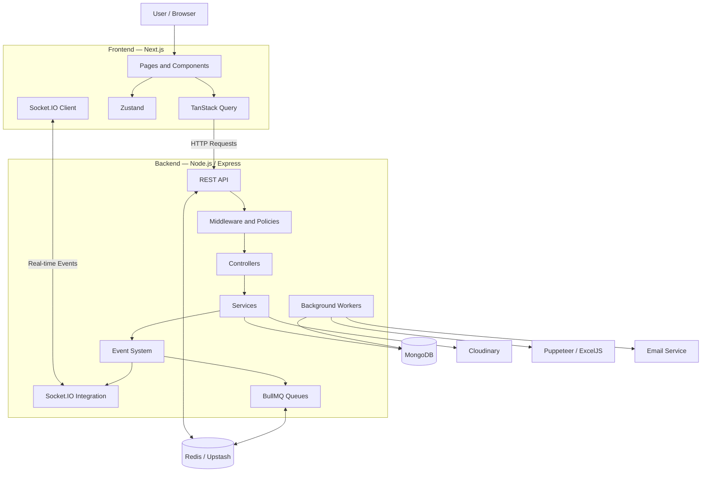

# AdminSphere — System Architecture

## 1. Overview

AdminSphere is a full-stack admin and task management platform built to demonstrate practical full-stack and backend engineering concepts.

The application consists of two independently running applications:

- **Client:** Next.js application responsible for the user interface, navigation and client-side state.
- **Server:** Node.js and Express application responsible for business logic, authentication, authorization, data persistence and background processing.

MongoDB is the primary database, while Redis supports session management and background job processing.

## 2. Technology Stack

| Layer | Technologies |
|---|---|
| Frontend | Next.js, React, TypeScript, Tailwind CSS |
| Client state | TanStack Query, Zustand |
| Forms and validation | React Hook Form, Zod |
| Backend | Node.js, Express |
| Database | MongoDB, Mongoose |
| Session management and queues | Redis, BullMQ |
| Authentication | JWT, Google OAuth 2.0 |
| Real-time communication | Socket.IO |
| File storage | Cloudinary |
| Reporting | Puppeteer, ExcelJS |
| Background scheduling | node-cron |
| Logging | Winston, Morgan |
| Deployment | Vercel, AWS EC2, Nginx, PM2 |

## 3. High-Level Architecture

The client communicates with the backend through REST APIs. Socket.IO provides a separate real-time communication channel.

The backend interacts with MongoDB for persistent application data and Redis for session-related operations and background job queues.

## 4. Backend Architecture

The backend follows a layered structure that separates HTTP handling, business logic, data access and external integrations.

### Directory responsibilities

| Directory | Responsibility |
|---|---|
| `config/` | Application and infrastructure configuration |
| `constants/` | Shared constants |
| `controllers/` | Handle incoming requests and construct HTTP responses |
| `cron/` | Scheduled job definitions |
| `errors/` | Custom application errors |
| `events/` | Application event definitions and handling |
| `integrations/` | External and infrastructure integrations, including PDF and Socket.IO |
| `middlewares/` | Authentication, validation, error handling and other request middleware |
| `models/` | Mongoose schemas and database models |
| `policies/` | Authorization and resource-level access rules |
| `queues/` | BullMQ configuration, queues and workers |
| `routes/` | API route definitions |
| `seeders/` | Database seeding utilities |
| `services/` | Business logic and application operations |
| `uploads/` | Upload-related functionality |
| `utils/` | Shared utility functions |
| `views/` | EJS templates used for report generation |

### Request lifecycle

A typical REST API request follows this structure:

1. The client sends an HTTP request.
2. The route matches the requested endpoint.
3. Middleware performs authentication, validation and other required checks.
4. Policies enforce permission and resource-level access rules where applicable.
5. The controller handles the request and delegates business operations to a service.
6. The service performs the required business logic and database operations.
7. The controller sends the HTTP response.

This separation keeps controllers focused on HTTP concerns while services handle application logic.

## 5. Frontend Architecture

The frontend uses the Next.js App Router and follows a feature-oriented structure.

### Directory responsibilities

| Directory | Responsibility |
|---|---|
| `app/` | Application routes, layouts and pages |
| `components/` | Reusable and feature-specific UI components |
| `constants/` | Shared frontend constants |
| `hooks/` | Custom React hooks |
| `lib/` | Shared libraries and React Query configuration |
| `providers/` | Application-level context providers |
| `public/` | Static assets |
| `schemas/` | Zod validation schemas |
| `services/` | API communication and feature-specific service functions |
| `store/` | Zustand global state |
| `styles/` | Global and shared styles |
| `types/` | Shared TypeScript types |

### State management

The frontend uses two complementary state management approaches.

**TanStack Query**
- Manages server state.
- Handles API requests and caching.
- Supports query invalidation and cache updates.
- Keeps task, dashboard and notification data synchronized.

**Zustand**
- Manages client-side global state.
- Stores authentication-related and other shared UI state.
- Provides shared state access across components.

### API communication

API calls are organized into service modules rather than being scattered throughout UI components.

Axios handles HTTP communication with the backend. React Hook Form and Zod handle form state and validation.

## 6. Authentication and Session Management

AdminSphere uses JWT-based authentication with access and refresh tokens stored in HTTP-only cookies. Redis provides server-side session management, allowing sessions to be validated and revoked independently of access-token expiration.

### Login flow

1. The user submits their username/email and password.
2. The backend retrieves the user and associated role permissions.
3. The authentication service validates the authentication provider, account lock status and password.
4. A unique session ID is generated for the login session.
5. Access and refresh tokens are generated using the user ID and session ID.
6. The refresh token is hashed, and the hash along with session metadata is stored in Redis.
7. The backend returns authentication tokens through HTTP-only cookies and user information in the response.
8. The frontend updates its Zustand authentication store and navigates to the dashboard.

### Access-token validation

For protected API requests:

1. Authentication middleware reads the access token from request cookies.
2. The JWT signature and expiration are verified.
3. The middleware extracts the user ID, session ID, role and permissions.
4. The corresponding session is retrieved from Redis.
5. If the session is valid, the user context is attached to `req.user` and request processing continues.

This adds server-side session validation to JWT authentication, allowing sessions to be revoked without waiting for access tokens to expire.

### Refresh-token rotation

When an access token expires, the frontend Axios response interceptor handles the refresh flow.

1. The backend responds with HTTP 401.
2. The Axios interceptor sends a refresh request using a separate Axios client.
3. The backend verifies the refresh token and retrieves the corresponding Redis session.
4. The incoming refresh token is hashed and compared with the stored hash.
5. If the hashes match, a new access token and refresh token are generated.
6. The new refresh token hash replaces the previous hash in Redis.
7. The frontend retries the original failed request.

If the refresh token hash does not match, the session is revoked to handle potential refresh-token reuse.

### Concurrent refresh handling

The frontend maintains a shared refresh promise. When multiple API requests receive HTTP 401 responses simultaneously, they wait for the same refresh operation instead of independently initiating multiple refresh requests.

After a successful refresh, each original request can be retried.

### User hydration and logout

On initial application load, the frontend uses a current-user query to retrieve the authenticated user through the `/me` endpoint.

The backend validates the access token and Redis session, then retrieves the latest user information and role permissions from MongoDB.

The frontend stores the returned user in Zustand. This allows the application to restore authentication state after a browser refresh without persisting the user object as the source of truth.

During normal logout, the backend deletes the corresponding Redis session and records the logout event. The frontend clears the Zustand user, removes the current-user query and redirects to the login page.

### Additional authentication capabilities

- Multiple active sessions across devices.
- Server-side session validation through Redis.
- Refresh-token hashing and rotation.
- Refresh-token reuse detection.
- Session revocation and logout.
- Login failure tracking and temporary account lockout.
- Google OAuth 2.0 authentication and account linking.
- Password reset functionality.

## 7. Authorization and Access Control

Authentication establishes the user's identity, while authorization determines which operations they are allowed to perform.

AdminSphere uses role-based access control (RBAC) combined with resource-level policies.

- Roles define the permissions assigned to users.
- Role permissions are included in access-token claims.
- Authentication middleware attaches the user's identity, role and permissions to `req.user`.
- Authorization middleware and policies enforce permission and resource-level access rules.
- Frontend route guards provide an additional navigation and UI access-control layer.

Frontend checks are intended for user experience; backend middleware and policies remain responsible for enforcing access control on protected operations.

During token refresh, the user's current role and permissions are retrieved again and included in the newly generated access token.

## 8. Event-Driven and Real-Time Communication

The backend uses Node.js EventEmitter to decouple certain operations from their secondary side effects.

For example, a task-related operation can trigger additional activities such as:

- Activity tracking.
- Notification creation.
- Email notifications.
- Real-time updates.

Socket.IO provides real-time communication between the backend and frontend.

The backend handles authenticated socket connections and organizes clients into appropriate rooms, including user-specific and dashboard-related rooms.

The overall communication flow is:

1. The backend performs an application operation.
2. Application events trigger associated side effects.
3. Socket.IO emits updates to the relevant rooms or connected clients.
4. The frontend receives the event.
5. TanStack Query updates or invalidates the relevant cached data.
6. The UI reflects the updated state.

Notifications are persisted in MongoDB, allowing users to retrieve missed notifications when they reconnect rather than relying exclusively on live socket events.

## 9. Background Job Processing

AdminSphere uses BullMQ with Redis to execute selected operations asynchronously.

The API server and background worker run as separate Node.js processes.

**Processing flow:**

1. The API or scheduled task adds a job to a BullMQ queue.
2. BullMQ stores the job in Redis.
3. A background worker retrieves and processes the job.
4. The worker performs the required operation.
5. Job retries and failure handling are managed through BullMQ configuration.

Current background processing includes:

- Asynchronous welcome emails.
- Daily user report generation and email delivery.
- Scheduled report jobs triggered through node-cron.

Separate queues and workers allow different workloads to use different concurrency settings. For example, email jobs use higher concurrency, while PDF generation uses lower concurrency because browser-based rendering is more resource-intensive.

See [Background Jobs](../server/docs/background-jobs.md) for implementation details.

## 10. Reporting and File Handling

### PDF reports

Puppeteer is used to generate PDF reports from EJS templates.

Scheduled report generation runs through the background job system, avoiding unnecessary blocking of API request handling.

### Excel exports

ExcelJS is used to generate Excel reports and downloadable spreadsheets.

### File uploads

Multer handles incoming file uploads using memory storage. Uploaded files are processed and transferred to Cloudinary, while the application maintains the associated file metadata.

## 11. Deployment Architecture

The production deployment uses separate hosting environments for the frontend and backend.

- **Frontend:** Deployed on Vercel.
- **Backend:** Hosted on AWS EC2.
- **Reverse proxy:** Nginx.
- **Process management:** PM2.
- **SSL:** HTTPS configured through Certbot.
- **Database:** MongoDB Atlas.
- **Redis:** Upstash Redis.

The backend runs the API server and background worker as separate managed processes.

Backend CI/CD automates validation and deployment. The production deployment configuration and operational workflow are maintained separately from this public repository.

See [CI/CD Overview](../server/docs/cicd.md) for the sanitized CI/CD documentation.

---

*This document describes the current application architecture. Some implementation details may evolve as the project develops.*